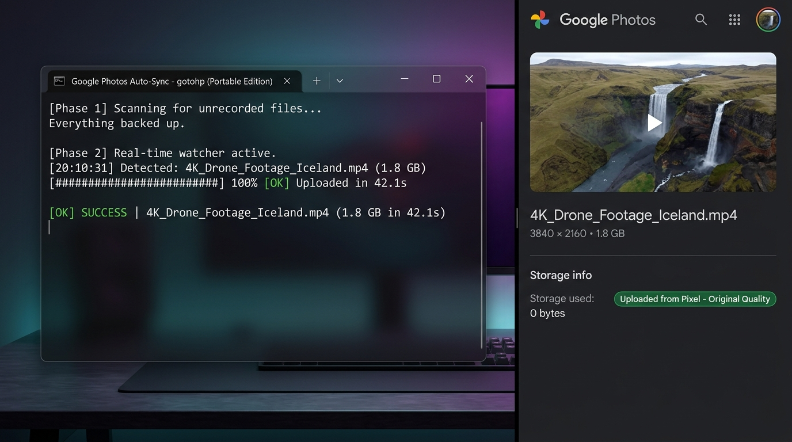

# GoogleUnlimited

> **Zero-Quota, Unlimited Google Photos Auto-Sync for Windows & Linux**  
> Native background watcher that automatically uploads photos and videos with **Google Pixel original quality unlimited backup** — without WSL, WSA, Android emulators, or Morphe crashes.

<p align="center">
  
</p>

---

## Features

- **Unlimited Google Photos Backup**: Spoofs Google Pixel mobile upload API ([`xob0t/gotohp`](https://github.com/xob0t/gotohp)) so all uploaded photos and videos consume **0 bytes of Google Drive / Google One storage**.
- **Cross-Platform (Windows & Linux)**: Native PowerShell engine on Windows and native POSIX Bash + `inotify` engine on Linux. No emulators or virtual machines.
- **Dual-Boot Interoperability**: Windows and Linux scripts share the exact same SQLite database schema (`gphotos.db`), with dual-key lookups (`path` + `filename|filesize`) to seamlessly prevent duplicate uploads on shared partitions.
- **Portable & Zero-Install**: Runs from any directory, on any PC or USB drive without system-wide installation.
- **Unified 1-File Managers**:
  - **Windows**: `GoogleUnlimited.bat` provides an interactive menu or CLI commands (`watch`, `silent`, `status`, `logs`, `enable`, `disable`, `stop`).
  - **Linux**: `google-unlimited.sh` provides an interactive menu or CLI subcommands (`watch`, `status`, `logs`, `setup`, `enable`, `disable`, `stop`).
- **Real-Time Auto-Sync**: Monitors standard user folders instantly when files are downloaded or saved, with debounce protection for active downloads.
- **Embedded SQLite Tracking**: Tracks every upload in `gphotos.db` — zero duplicate re-uploads, crash-resilient with automatic retry queues.
- **Live Terminal Progress Bar**: Real-time dynamic progress bar, elapsed timer, and file size indicator.
- **Background Auto-Start**: 
  - Windows: 1-click startup installer or silent VBScript launcher (`StartPhotosWatcher.vbs`).
  - Linux: 1-command user systemd service auto-start (`./google-unlimited.sh enable`).

---

## Directory Structure

```text
GoogleUnlimited/
│
├── Modules/
│   └── PSSQLite/             # Bundled portable SQLite engine for Windows PowerShell
│
├── gotohp-cli-x64.exe        # Windows 64-bit CLI uploader with Pixel spoofing
├── gotohp-x64.exe            # Windows desktop GUI for one-click Google OAuth sign-in
├── gotohp-cli_amd64          # Native Linux x86_64 ELF binary
│
│   # --- Windows ---
├── GoogleUnlimited.bat       # Unified Windows Manager (interactive menu + CLI commands)
├── StartPhotosWatcher.vbs    # Windows silent background launcher (zero window)
├── WatchAndUpload.ps1        # Core Windows PowerShell orchestrator
│
│   # --- Linux ---
├── google-unlimited.sh       # Unified Linux Manager (watcher, setup, status, systemd)
│
├── .gitattributes            # Line ending preservation (LF on shell scripts)
├── .gitignore                # Protects credentials, tokens, and personal databases
├── README.md                 # Documentation
└── reddit_showcase.jpg       # Showcase graphic
```

---

## Windows Setup & Usage

### 1. Download or Clone
```cmd
git clone https://github.com/shishir0x/GoogleUnlimited.git
```

### 2. Sign In to Google Photos (One-Time)
1. Double-click **`gotohp-x64.exe`** and click **Add Google account**.
2. Click **Open Google sign-in** and sign in with your Google account.
3. Sign in on the Google Embedded Setup page and click **I agree**.  
   *(Note: The page buffering indefinitely is completely normal and expected).*
4. Open browser Developer Tools (**F12**):
   - Go to **Application** tab (Chrome/Edge/Brave) or **Storage** tab (Firefox).
   - Under **Cookies**, click `https://accounts.google.com`.
   - Copy the value of the **`oauth_token`** cookie.
5. In `gotohp`, paste the token and click **Connect account**.
6. Once connected, your credentials are saved locally. Close the GUI.

### 3. Run on Windows
Double-click **`GoogleUnlimited.bat`** to open the interactive manager:
```text
==========================================================
  *  Google Unlimited Photos Auto-Sync (Windows)
==========================================================
  [1] Start Live Watcher (Interactive progress)
  [2] Start Background Watcher (Silent, zero window)
  [3] Check Backup Status
  [4] View Activity Logs
  [5] Enable Auto-Start on Windows Boot
  [6] Disable Auto-Start on Windows Boot
  [7] Stop Background Watcher
  [0] Exit
==========================================================
```

You can also run any action directly from the terminal or shortcuts:
```cmd
GoogleUnlimited.bat watch     # Live terminal watcher with progress bar
GoogleUnlimited.bat silent    # Silent background run (zero window)
GoogleUnlimited.bat status    # Check total uploads and retry queue
GoogleUnlimited.bat logs      # View last 30 sync activity logs
GoogleUnlimited.bat enable    # Enable auto-start on Windows boot
GoogleUnlimited.bat disable   # Disable auto-start on Windows boot
GoogleUnlimited.bat stop      # Stop any running background watcher
```

---

## Linux Setup & Usage

GoogleUnlimited runs natively on any Linux distribution (Ubuntu, Debian, Fedora, Arch Linux, openSUSE, etc.) using `inotify-tools`, `sqlite3`, and the native Linux `gotohp` binary.

### 1. Clone the Repository
```bash
git clone https://github.com/shishir0x/GoogleUnlimited.git
cd GoogleUnlimited
```

### 2. One-Command Setup
Run setup to auto-install dependencies (`inotify-tools`, `sqlite3`, `curl`):
```bash
chmod +x google-unlimited.sh
./google-unlimited.sh setup
```

### 3. Sign In (One-Time)

You have two simple ways to sign in on Linux:

#### Option A: Retrieve `oauth_token` via Browser
1. In any web browser, open the Google Embedded Setup sign-in page:  
   👉 **[https://accounts.google.com/embedded/setup/v2/android](https://accounts.google.com/embedded/setup/v2/android)**
2. Sign in with your Google account and click **I agree**.  
   *(The screen may stay loading/buffering indefinitely; this is expected).*
3. Press **F12** (or right-click → **Inspect**) to open browser Developer Tools:
   - Click the **Application** tab (Chrome / Brave / Edge) or **Storage** tab (Firefox).
   - In the left sidebar, expand **Cookies** → click `https://accounts.google.com`.
   - Find the cookie named **`oauth_token`** and copy its full value.
4. In your Linux terminal, run:
   ```bash
   ./google-unlimited.sh creds add "<oauth_token>"
   ```
5. Verify your active account:
   ```bash
   ./google-unlimited.sh creds list
   ```

#### Option B: Copy from Windows (Fastest for Dual-Boot / Shared Drives)
If you already signed in on Windows:
Simply copy the generated `gotohp.config` file from your Windows folder into your Linux project directory:
```bash
cp /path/to/windows/GoogleUnlimited/gotohp.config ~/GoogleUnlimited/
```
The Linux watcher will detect `gotohp.config` and authenticate automatically.

### 4. Run on Linux
Run `./google-unlimited.sh` in your terminal to open the interactive manager:
```text
==========================================================
  *  GoogleUnlimited - Linux Manager
==========================================================
  [1] Start Live Watcher (Foreground)
  [2] Check Backup Status
  [3] View Activity Logs
  [4] Run Setup & Dependency Installer
  [5] Enable Auto-Start on Boot (systemd)
  [6] Disable Auto-Start on Boot
  [7] Stop Background Watcher
  [0] Exit
==========================================================
```

Or pass any command directly:
```bash
./google-unlimited.sh watch      # Interactive terminal with live progress
./google-unlimited.sh enable     # Auto-start on boot via systemd user service
./google-unlimited.sh disable    # Disable systemd startup service
./google-unlimited.sh status     # View upload statistics and retry queue
./google-unlimited.sh logs       # View recent activity logs with colors
./google-unlimited.sh stop       # Terminate background watcher
```

---

## Monitored Folders (Dynamic Resolution)

The watcher monitors standard user directories across both operating systems:
- `Downloads`
- `Pictures`
- `Desktop`
- `Documents`
- `Music`
- `Videos`

On Windows, directories are dynamically resolved via Windows Shell API & Registry (handling custom drive paths and OneDrive redirection). On Linux, standard XDG user directories are automatically resolved.

### Supported File Extensions
- **Images**: `.jpg`, `.jpeg`, `.png`, `.heic`, `.webp`, `.gif`, `.dng`
- **Videos**: `.mp4`, `.mov`, `.mkv`, `.avi`

---

## Privacy & Security

- **Direct Connections Only**: Every API request and media upload connects directly from your machine to official Google Photos endpoints (`photoslibrary.googleapis.com`). No intermediate or third-party servers are involved.
- **Local Credentials**: Authentication tokens and config files stay strictly on your local machine.
- **Git Protection**: The `.gitignore` file excludes:
  - Database files (`gphotos.db`, `*.db`, `*.db-wal`, `*.db-shm`)
  - Personal config files and tokens (`gotohp.config`, `*.config`, `*.token`)
  - Log files and temporary cache
  Your personal file history and login tokens are **never** committed or pushed to Git.
- **Zero Telemetry**: No tracking, analytics, or external telemetry of any kind.

---

## Troubleshooting & Issues

If you encounter any bugs, unexpected behavior, or need help:
- Run `./google-unlimited.sh status` (Linux) or `GoogleUnlimited.bat status` (Windows) to check queue and database status.
- Run `./google-unlimited.sh logs` (Linux) or `GoogleUnlimited.bat logs` (Windows) to inspect error details.
- Please submit an issue on the GitHub repository:  
  👉 **[Report an Issue on GitHub](https://github.com/shishir0x/GoogleUnlimited/issues)**

---

## License & Credits

- Core Pixel upload engine powered by [`xob0t/gotohp`](https://github.com/xob0t/gotohp).
- Windows SQLite integration powered by `PSSQLite`.
